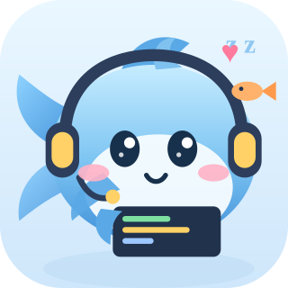

# 大肥鱼 · 网页左下角的看板娘

**2026 Qoder 高校创造力大赛 · LifeHack 生活娱乐赛道 · 团队 oceanplay**

[](https://fat-fish-in-my-web-k9qghxjx4u5.qoder.website/)
[](https://github.com/JINRONG121312/whale-girl-for-competitions/stargazers)
[](LICENSE)
[](#%E4%B8%BA%E4%BB%80%E4%B9%88%E6%98%AF-150-kb)
[](#%E5%BF%AB%E9%80%9F%E6%8E%A5%E5%85%A5)
[](docs/competition-post.md)

> 一只住在网页左下角的 Q 版大肥鱼：会写代码、会摸鱼、会被龙虾娘查岗、会读你的弹幕。

在线体验（Qoder Sites，打开就能玩）：**https://fat-fish-in-my-web-k9qghxjx4u5.qoder.website/**

| 参赛信息 | |
|---|---|
| 团队 | **oceanplay** |
| 作者 | **公冰蓝**（GitHub：JINRONG121312） |
| 赛道 | LifeHack · 生活娱乐 |
| 开发工具 | Qoder（模型 Qw3.8-Flash，一次连续工作约 1 小时）：写代码、起服务、在浏览器里 Debug、一键发布 |
| 原版仓库 | https://github.com/JINRONG121312/whale-in-my-web |

这个仓库是**参赛版**：角色按「Q 版大肥鱼」重绘，挂件在原版基础上补了参数注入、演示用查岗事件、气泡锁、拖动边界钳制和手机端交互，并配了一个能真的玩的展示站。



---

## 这个仓库里有什么

```
web/                     参赛展示站（Qoder Sites 的部署目录，双击 index.html 也能看）
  index.html             展示站页面
  app.js                 展示站逻辑：实时遥测、弹幕、参数定制、接入代码生成
  styles.css             展示站样式（深海观测窗主题）
  src/whale-girl.js      挂件本体（状态机 + 渲染 + 拖动 + 弹幕回复 + 角色 SVG）
  src/whale-girl.css     挂件样式（暗色模式、移动端、动效）
  assets/fat-fish.svg    Q 版大肥鱼立绘
  img/lobster.svg        龙虾娘老板
  assets/shots/          作品截图
src/                     原版鲸鱼娘挂件（whale-girl.* 与 danmaku.*）
assets/                  原版立绘、头像、水印与 SHA-256 清单
demo/                    原版演示页，双击即可运行
docs/competition-post.md 天池论坛参赛帖正文（可直接发布）
docs/report.md           技术报告（学术体例：摘要/相关工作/形式化/评估）
docs/post.md             项目复盘
CHANGELOG.md             版本记录
LICENSE                  PolyForm Noncommercial 1.0.0（非商业）
COMMERCIAL.md            商业授权说明
```

## 特性

| 能力 | 说明 |
|---|---|
| 状态机 | `work` → `slack`（每 20s，持续 4s）→ 可能被 `boss` 查岗；深夜 `sleep`；连点 `angry` |
| 经济系统 | 打赏 +8，被抓 −6，但**上限 +6**（越被抓罐子越大）；攒满一罐直接换班 |
| 互动分流 | 点鱼身 = 摸摸，+8 并甩尾游开；卡片里的「打赏 +8」是同一个罐子的第二个入口，窄屏也能用 |
| 气泡锁 | 一句台词占住气泡 15 秒（`HOLD_MS`），后续消息排队不覆盖 |
| 弹幕联动 | 监听 `wg:danmaku`，按关键词 + 昵称接话；`wg:boss` 可从外部召唤查岗 |
| 拖动 | 拖到任意位置，`clampPos()` 钳在视口内，超过 62% 宽度时气泡自动翻转 |
| 参数注入 | `window.WG_CONFIG` 或地址栏 `?slack=&boss=&penalty=&cap=` 直接改作息 |
| 移动端 | 收成圆形头像，点一下展开小卡片，卡片里有「点词接话」快捷气泡；查岗与生气照常，逃脱走打赏按钮 |
| 暗色模式 | 跟随 `html[data-theme="dark"]` |
| 体积 | gzip 后 **15.0 KB**，零运行时依赖，主角色内联在脚本里 |

## 快速接入

```html
<script defer src="src/whale-girl.js"></script>
<link rel="stylesheet" href="src/whale-girl.css">
```

想先调作息，在脚本**之前**注入参数：

```html
<script>
  window.WG_CONFIG = { slackEvery: 20, bossChance: 0.7, penalty: 6, capStep: 6 };
</script>
```

或者直接挂在地址栏上：`?slack=8&boss=0.9&penalty=10&cap=4`。

> 静态资源带 `?v=` 版本号。改完代码不带版本号的话浏览器根本不会重新下载——我自己被这个坑骗过一整天。

## 让她回弹幕

挂件自己不产生数据，只监听事件：

```js
document.dispatchEvent(new CustomEvent('wg:danmaku', {
  detail: { name: '前端小李', text: '这个 bug 又出现了' }
}));
```

她会按关键词（bug / 摸鱼 / 老板 / 代码 / 工资 / 产品 / 夸夸）挑一句回，偶尔把昵称带在前面。

召唤一次查岗（演示用，正式接入不需要）：

```js
document.dispatchEvent(new CustomEvent('wg:boss'));
```

## 可调参数

全部在 `web/src/whale-girl.js` 顶部，默认可被 `window.WG_CONFIG` 覆盖：

```js
var SLACK_EVERY = 20;     // 多久摸一次鱼
var SLACK_LEN = 4;        // 摸鱼持续
var BOSS_CHANCE = 0.7;    // 每秒被查岗的概率
var BOSS_LEN = 3;         // 查岗持续
var ESCAPE_CHANCE = 0.15; // 被抓时点一下能溜掉的概率
var PENALTY = 6;          // 被抓扣多少
var CAP_STEP = 6;         // 被抓后上限涨多少
```

## 验收

这套检查是 Qoder 自己去浏览器里跑的，不是「改完让你刷新看看」：起本地服务 → 拉起无头浏览器 → 注入断言 → 两套视口各跑一遍 → 全程挂 console 监听 → 截图回看布局。今天那两个问题（气泡上拖不动的滚动条、窄屏被 `disabled` 掉的遥控按钮）就是这么在运行时里复现并定位的，顺带还抓出一个用户没报的竞态——被抓后同一次摸鱼里重复查岗，金币被二次扣减。

本地起静态服务后，用 headless Edge 在 **1440×900** 和 **390×844** 两套视口跑交互检查：投喂、摸摸、查岗、逃脱、连戳生气、10 秒消气、气泡锁、弹幕回复、快捷词、主题持久化、参数应用、接入代码生成、窄屏收成头像与展开、窄屏查岗与连戳、拖动钳边与气泡翻转……**54 项全部通过，控制台无报错，无横向溢出，气泡容器不再出现滚动条**。改完必须重跑一遍才重新发布。

## 原创与资产

- 角色立绘、代码、文案、截图均为**原创**，作者公冰蓝（JINRONG121312）。
- 最初想做的是当时很火的「鲸鱼娘」桌宠主题，Qoder 提醒那个素材是 **CC BY-NC-SA**、不能搬运，于是让 Qoder 重新生成了一版原创的大肥鱼形象，并把她的动作补全。
- 参赛版新增的交互（打赏/摸摸分流、气泡锁、拖动钳制、手机端快捷气泡、参数注入）移植自我本人另一款 Hexo 博客里的鲸鱼插件——同一个作者，不是他人作品。
- 博客版带一个 AI 聊天后端，这次**没有**移植：站点是 HTTPS，后端是 HTTP 且没有 CORS；而且为了聊天引入服务器，和「小、省、零依赖」的前提是冲突的。
- 图片资产带有可见水印与 PNG 元数据，文件级 SHA-256 记录在 [assets/NOTICE.md](assets/NOTICE.md)，可用于比对副本。

转载本项目截图时，保留水印或注明仓库地址即可。

## 许可

本项目采用 **[PolyForm Noncommercial License 1.0.0](LICENSE)**。

| 用途 | 是否需要授权 | 费用 |
|---|---|---|
| 个人博客、作品集、学习研究、公益与教育机构 | 不需要 | 免费 |
| 公司官网、付费产品、SaaS、外包交付、广告变现站点 | **需要** | 年费 + 营收分成 |

商业授权按「年费 + 营收分成（参考 3%–10%）」协商，也可以一次性买断。细则见 **[COMMERCIAL.md](COMMERCIAL.md)**，申请请开一个以 `[Commercial]` 开头的 Issue。

> 严格来说这不是 OSI 定义的开源许可（"开源"通常允许商业使用），而是**源码公开的非商业许可**（source-available, noncommercial）。请按这个理解使用。

思路和设计可以随便借鉴——**思想不受版权保护，欢迎你做一个更好的**。

## 为什么是 15.0 KB

因为原来那个站点跑在 **2 核 2G、3 Mbps** 的云服务器上，公网峰值 375 KB/s——每多 100 KB，访客就多等 0.27 秒。

所以这里没有 Live2D（模型起步 1–3 MB）、没有位图、没有框架运行时。参赛版按 gzip level 9 实测：

| 文件 | gzip |
|---|---|
| `whale-girl.js`（状态机、渲染、交互、文案 + 内联鱼形 SVG） | 10,618 B |
| `whale-girl.css`（主题、动效、响应式） | 3,921 B |
| `lobster.svg`（第二角色） | 815 B |
| **合计** | **15,354 B ≈ 15.0 KB** |

对比主流 Live2D 看板娘（1–3 MB），是 **68×–205×** 的差距。推导过程与效度威胁见原版 [docs/report.md](docs/report.md)。

## 说明

配色、文案、数值都是为一个具体的小站点调的，把它当成一个有性格的小玩具，而不是通用组件库。改坏了 Ctrl+Z 就好。
